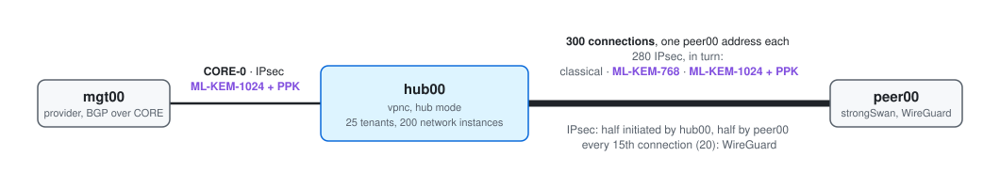

# Lab tests

The tests run against containerlab labs and check end results in the lab.

| Directory | What | Time |
|---|---|---|
| `00_setup/` | The host's prerequisites (Docker, containerlab, Jool, test tools) and the images | |
| `00_base/` | The base lab: topology, node configuration and lab scripts | |
| `00_scale/` | The scale lab | |
| `00_fuzz/` | The fuzz lab: the base lab's nodes, for tests that wreck it | |
| `01_sanity/` | The freshly deployed lab is configured and working. Read-only. | seconds |
| `02_reliability/` | Configuration changes, drift and failures (outages, restarts, lost sessions) are handled. Disrupts the lab and restores it. | ~20 min |
| `03_performance/` | 200 network instances and 300 connections, in the scale lab. | ~10 min |
| `04_fuzz/` | Generated configuration, API requests, DNS answers, IKE packets, tenant traffic, faults and crashes (Hypothesis, Schemathesis), in the fuzz lab. May leave it broken. | ~20 min with `FUZZ_EXAMPLES=25` |

## Setup

Once per host (Ubuntu 26.04), then log in again for the docker group:

```sh
sudo test/00_setup/install.sh
```

Then build the images, after each change to vpnc:

```sh
sudo test/00_setup/build-image.sh 26.04
```

## Base lab

```sh
sudo test/00_base/deploy-base.sh 26.04
sudo test/00_base/healthcheck.sh
sudo python3 -m pytest test/01_sanity        # quick check
sudo python3 -m pytest test/02_reliability   # full check
sudo test/00_setup/diagnostics.sh            # when something fails
```

Run the sanity tests on a fresh lab, before the reliability tests.


hub00/hub01 run vpnc in hub mode, end00/end01 in endpoint mode. mgt00/mgt01 are
the provider side (strongSwan, FRR); cli00/cli01 are customer networks behind
end00/end01. The labels show what each tunnel uses. mgt00 sends its traffic
through hub00 and mgt01 through hub01, so the tests' traffic crosses both hubs.

The containers have tini as init (PID 1): `docker stop` stops vpnc as systemd
would, and what daemons leave behind is reaped. A container stops when its vpnc
exits.

## Scale lab

Runs next to the base lab, with its own bridge and container names.



The tests add the tenants C0100-C0124 to hub00; peer00 is the other end of all
their connections.

```sh
sudo test/00_scale/deploy-scale.sh 26.04
sudo python3 -m pytest test/03_performance
```

The run ends with its measurements: apply and recovery times, idle CPU.

## Fuzz lab

The base lab's nodes and configuration, next to the base lab, with its own bridge,
management network and container names (`clab-vpnc-fuzz-*`). Tests that leave the
lab in an unknown state run here, so other runs keep a working base lab.

```sh
sudo test/00_fuzz/deploy-fuzz.sh 26.04
sudo test/00_base/healthcheck.sh vpnc-fuzz
sudo VPNC_LAB=vpnc-fuzz python3 -m pytest test/01_sanity
sudo test/00_setup/diagnostics.sh vpnc-fuzz
```

`VPNC_LAB` selects the lab the tests run in; without it, the base lab.

```sh
python3 -m pytest test/04_fuzz                         # on its own: skipped next to other suites
FUZZ_EXAMPLES=25 python3 -m pytest test/04_fuzz        # the number the tests scale their examples by, default 100
python3 -m pytest test/04_fuzz --hypothesis-show-statistics
```

The fuzz tests need `python3-hypothesis`. A failure prints the smallest input that
fails; it's kept in `test/04_fuzz/.hypothesis` and tried first in the next run.

| Test | Generates | Examples |
|---|---|---|
| `test_config_input` | Configuration files and API requests, valid or not; files written in place or moved into place; true, false or a number in place of a number or an address is refused | 3× |
| `test_api_schema` | API requests from the OpenAPI schema (Schemathesis) | 1× per route |
| `test_dns_answers` | DNS answers that vpncmangle translates: well-formed with any records, broken in a place, or anything | 10× |
| `test_config_states` | Sequences of 10 valid changes to a tenant; hub00 restarts after half of them | 1/5 |
| `test_network_faults` | The same, with hub00's uplink down, flapping, losing or delaying packets | 1/10 |
| `test_restarts` | The same, with charon, vpncmangle, an FRR daemon or vpnc killed or hanging, or hub00 restarted right after a commit | 1/10 |
| `test_concurrency` | API calls and hand edits at the same time; hub00 restarts after a quarter of them | 1× |
| `test_ike_packets` | IKE messages to charon from a peer's address: first messages of IKEv2 and IKEv1 that charon answers, any payloads, later exchanges | 10× |
| `test_tenant_traffic` | Packets from tenants through their tunnels (any range, protocol, ICMP type, options, fragments), and spoofed DNS answers | 10× |

Besides vpnc's own state, the tests check that charon, FRR and vpncmangle run,
answer and took the configuration (charon and WireGuard: each connection's
peers, ids, lifetimes, traffic selectors, port and keys), that the nftables
tables exist, and that BGP is up. The tenant traffic test checks, with a sniffer
in all of hub00's network instances, that nothing a tenant sends leaves its
network instance. A test that restarts hub00 links its uplink to the bridge
again: containerlab only adds links at deploy.

The tests are made to run many examples per hour:

- Commands and API calls go through a process that stays in each node
  (`conftest.Agent`), several at a time, instead of a `docker exec` each.
- Nothing waits a fixed time for packets. After an example's packets a sentinel
  takes the same way (a DNS answer that vpncmangle translates, an IKE message
  that charon always answers, a ping of hub00): once it's there, so is what
  came before it.
- vpnc handles changed files in turn: once it reports the change of a canary
  file (`conftest.Canary`), it handled the files written before it.
- An example only puts the configuration back if the one before changed it.
- A restart of hub00 takes about 20 s, as long as ten changes: the state
  machines draw whether a sequence ends with one.
- A peer that hub00 dropped in a crash only connects again after its dead peer
  detection, minutes later: the fault and restart tests check hub00's own
  recovery after each step, and wait for the peers once per sequence.

Without a version, the deploy scripts use the last built image (`latest`), as in CI.
