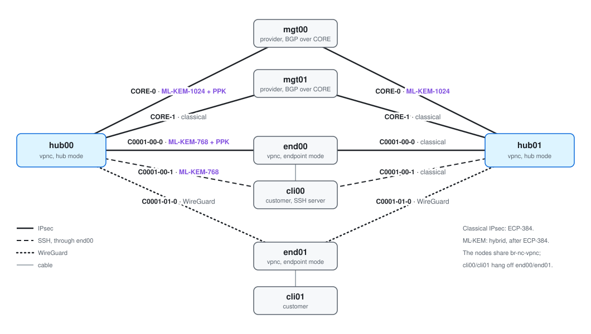

# Lab tests

The tests run against containerlab labs and check end results in the lab.

| Directory | What | Time |
|---|---|---|
| `00_setup/` | Images, the base and scale lab topologies, node configuration and lab scripts | |
| `01_sanity/` | The freshly deployed lab is configured and working. Read-only. | seconds |
| `02_reliability/` | Configuration changes, drift and failures (outages, restarts, lost sessions) are handled. Disrupts the lab and restores it. | ~20 min |
| `03_performance/` | 200 network instances and 300 connections, in the scale lab. | ~10 min |

## Base lab

```sh
sudo test/00_setup/build-image.sh 26.04
sudo test/00_setup/deploy-base.sh 26.04
sudo test/00_setup/healthcheck.sh
sudo python3 -m pytest test/01_sanity        # quick check
sudo python3 -m pytest test/02_reliability   # full check
sudo test/00_setup/diagnostics.sh            # when something fails
```

Run the sanity tests on a fresh lab, before the reliability tests.



hub00/hub01 run vpnc in hub mode, end00/end01 in endpoint mode. mgt00/mgt01 are
the provider side (strongSwan, FRR); cli00/cli01 are customer networks behind
end00/end01. The labels show what each tunnel uses. mgt00 sends its traffic
through hub00 and mgt01 through hub01, so the tests' traffic crosses both hubs.

The containers have tini as init (PID 1): `docker stop` stops vpnc as systemd
would, and what daemons leave behind is reaped. A container stops when its vpnc
exits.

## Scale lab

Runs next to the base lab, with its own bridge and container names.


The tests add the tenants C0100-C0124 to hub00; peer00 is the other end of all
their connections.

```sh
sudo test/00_setup/deploy-scale.sh 26.04
sudo python3 -m pytest test/03_performance
```

The run ends with its measurements: apply and recovery times, idle CPU.

Without a version, the deploy scripts use the last built image (`latest`), as in CI.
